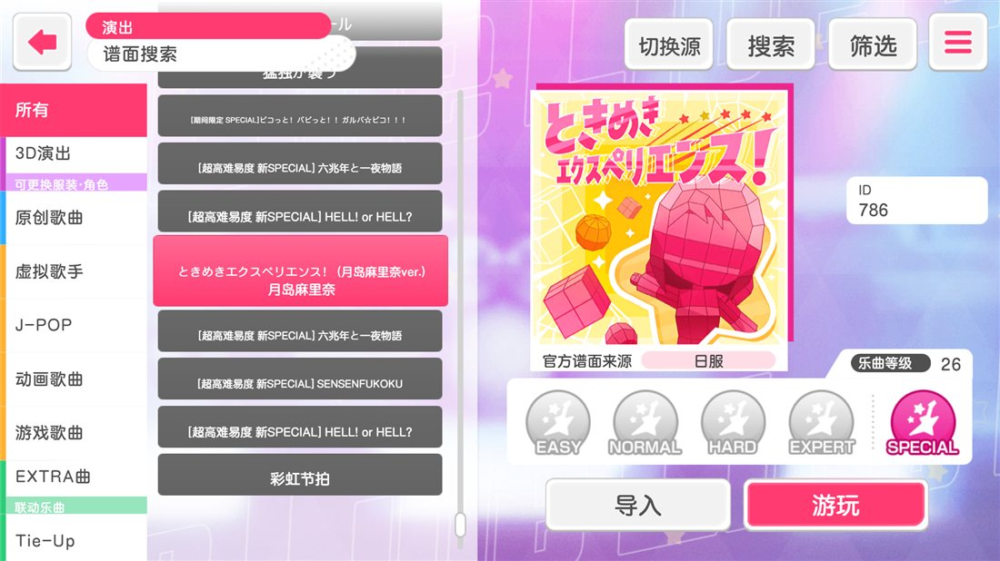
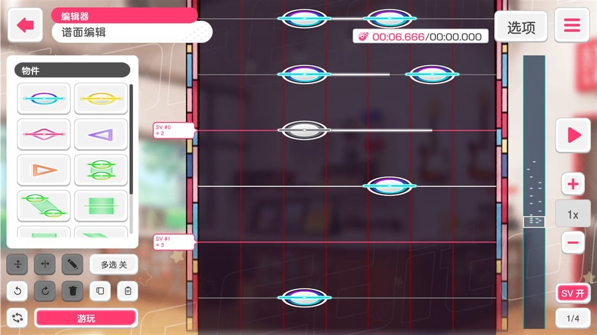
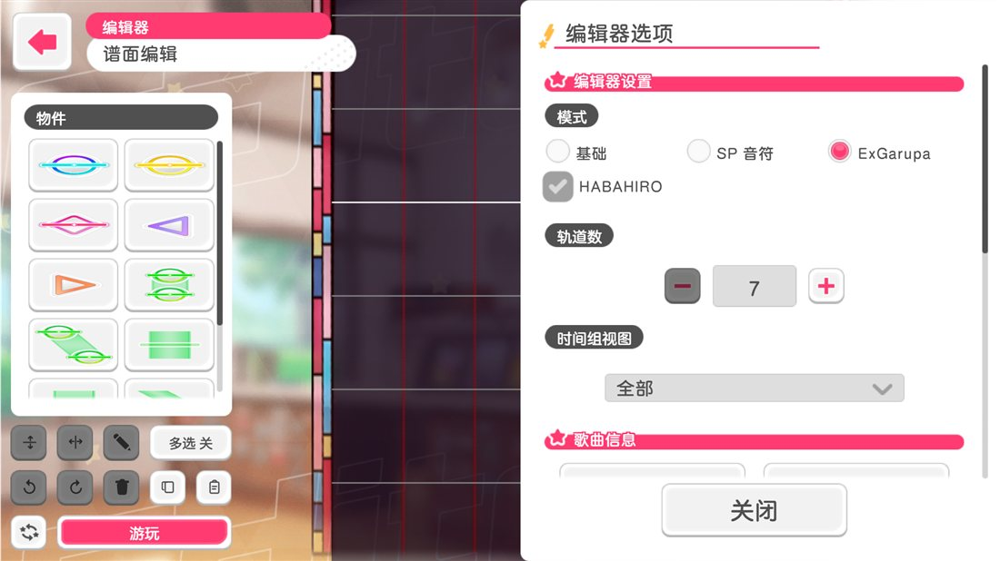

<div align="center">
  
  <h1>GarupaEditor</h1>
  <p><em>扩展的、多平台的 Garupa 自制谱制作工具，不仅是 Garupa 。</em></p>
</div>

基于 Tauri 架构，GarupaEditor 提供多平台的《BanG Dream! 少女乐团派对！》自制谱制作、预览、游玩、导入、导出与发布功能。

除基础的 Bestdori 兼容谱面制作外，GarupaEditor 同时支持：
- **ExGarupa 扩展**：9 / 11 / 13 轨道与界外音符、Slide 手势节点（Slide 的头或中间节点为 Flick / 方向滑键）、无头 / 无尾 Slide、无判定 Slide、变速 SV 与多时间组（TimingGroup）
- **HABAHIRO 模式**：源自原作日服歌曲 786「ときめきエクスペリエンス！（月島麻里奈ver.）」的 HABAHIRO SPECIAL 谱面（「HABAHIRO」即日语「幅広」，意为「宽幅」），是原作的一种特殊谱面模式而非扩展，支持多宽度音符与换轨演出（`LANE CHANGE`）
- **内置模拟器**：直接在应用内预览谱面或实机游玩，支持自定义皮肤、音效、流速、判定偏移与 MV 背景
- **在线曲库与多端互通**：支持在线检索、游玩和导入官服（日服 / 简中服 / 繁中服 / 国际服）、Bestdori 社区及 Ayachan 谱面，并可一键发布至 Bestdori 社区或 NotGarupa 服务器

## 安装

前往 [GitHub Releases](https://github.com/WindowsSov8forUs/GarupaEditor/releases) 下载对应平台的安装包：

### Windows

- 推荐下载 `*_windows_x64-setup.exe`（Intel / AMD）或 `*_windows_arm64-setup.exe`（Windows on ARM）双击安装（亦提供 `.msi` 安装包）。
- 当前安装包暂未进行代码签名，若安装时弹出 Microsoft Defender SmartScreen 的「Windows 已保护你的电脑」提示，确认安装包来自本项目 GitHub Releases 后，点击「更多信息」→「仍要运行」即可。

### macOS

- 下载 `*_darwin_aarch64.dmg`（Apple Silicon / M 系列）或 `*_darwin_x64.dmg`（Intel）。
- 打开 `.dmg` 后将 `GarupaEditor.app` 拖入「应用程序」。当前暂未签名公证，首次打开若提示无法验证开发者，请在访达中右键应用选择「打开」。

### Linux

- **Debian / Ubuntu**（`amd64` / `arm64`）：
  ```bash
  sudo apt install ./*_linux_amd64.deb
  ```
- **Fedora / RHEL / openSUSE**（`x86_64` / `aarch64`）：
  ```bash
  sudo dnf install ./*_linux_x86_64.rpm
  ```

### Android

- 下载并安装 `*_android_aarch64.apk`（未签名 APK，安装前需在系统中允许从当前来源安装应用）。

## 基础使用

### 1. 首页入口


- **谱面编辑**：新建谱面工程，或继续编辑当前工程。
- **谱面导入**：打开本地保存的 `.gcp` 完整谱面工程文件。
- **谱面搜索**：浏览在线曲库，直接游玩或导入现有谱面。
- **右上角菜单**：打开全局「选项」（演出设定、音量、皮肤、系统设置）、新建工程或登录 Bestdori 账号。

### 2. 谱面搜索与试玩



- 点击右上角 **切换源** 可在 **官方谱面**（日服 / 简中服 / 繁中服 / 国际服）、**Bestdori 社区** 与 **Ayachan** 之间切换，并通过 **搜索** 与 **筛选** 按关键词、ID、分类、难度或等级查找谱面。
- 选中曲目与难度后，点击 **游玩** 即可进入演出准备并启动内置模拟器游玩；点击 **导入** 可将该谱面连同音频、封面直接载入编辑器。

### 3. 谱面编辑



- **放置与修改**：在左侧「物件」栏选择音符或事件类型（Single、Skill、Flick、Long、Slide、Middle、Curve、BPM，以及 SP 音符模式及以上的方向滑键与 Hidden、ExGarupa 下的 SV、开启 HABAHIRO 时出现的 `LANE CHANGE`），在轨道上点击即可放置；点击已放置的音符可修改属性或拖拽位置（方向滑键在基础和 SP 音符模式下最宽 3 轨，开启 HABAHIRO 或 ExGarupa 后不限）。
- **编辑工具栏**：左侧下方提供上下/左右镜像翻转、单选/多选切换、撤销、重做、删除、复制与粘贴功能；左下角可点击 **游玩**（或切换为 **预览**）从当前位置实机测试谱面。
- **视图与播放控制**：右侧提供全谱缩略图、播放/暂停、倍速调节、SV 线显示开关（`SV 开/关`，仅 ExGarupa 下有）及拍号分度值（如 `1/4`）设置。
- **常用快捷键**：
  - `1`～`7`：快速切换音符与 BPM 工具
  - `Ctrl + Z` / `Ctrl + Y`（或 `Ctrl + Shift + Z`）：撤销 / 重做
  - `Ctrl + C` / `Ctrl + V`：复制选中物件 / 粘贴至鼠标位置
  - `Delete`：删除选中物件（`Ctrl + Shift + Delete` 清空全部音符）

### 4. 编辑器选项、歌曲信息与导出发布



点击编辑器右上角的 **选项** 打开设置与导出抽屉：

- **编辑器设置**：切换 **模式**（**基础** / **SP 音符** / **ExGarupa**）、勾选 **HABAHIRO**、调整 **轨道数**（7 轨为原作标准，ExGarupa 下可选 9 / 11 / 13 轨）以及切换 **时间组视图**（仅 ExGarupa 下有）。
  - **关于 HABAHIRO 与换轨（`LANE CHANGE`）**：HABAHIRO 源自原作日服歌曲 786「ときめきエクスペリエンス！（月島麻里奈ver.）」的 HABAHIRO SPECIAL 谱面（原作内部名 `786_miracle_april_habahiro_special`；「HABAHIRO」即日语「幅広」，意为「宽幅」），属于原作本身的特殊谱面模式而非扩展。开启 HABAHIRO 后：
    - 可以使用宽度大于 1 的普通音符（Single、Flick、Skill、Long、Slide），并解除方向滑键的 3 轨宽度限制；
    - 音符会切换为 HABAHIRO 专属的音符皮肤（编辑器开启 HABAHIRO 时自动切过去，关闭时自动切回）；
    - 可放置 **`LANE CHANGE`（换轨）** 事件，表示「从这里开始切换成 HABAHIRO 专属的轨道外观」的演出切换点：到达 `LANE CHANGE` 位置时，判定线会播放一段 HABAHIRO 专属的闪光动画，动画中途轨道（场地）皮肤从普通场地切换为 HABAHIRO 专属场地，此后整首歌都使用该场地。原作中换轨标记所在位置本身也是一个正常的 Single 音符，会参与判定和计分；编辑器里则作为单独放置的 `LANE CHANGE` 事件。
- **歌曲信息**：点击 **查看** 或 **编辑**，设置曲名、艺术家、谱师、难度、等级，并绑定本地音频、封面与背景 MV。
- **谱面导出与发布**：
  - **本地保存**：导出包含谱面与媒体的 `.gcp` 工程文件，或导出为兼容的 `Bestdori V2` JSON 文件。
  - **发布**：一键将当前谱面及音频、封面发布到 **测试服**、**Bestdori 社区** 或 **NotGarupa 服务器**（发布前需在菜单中登录 Bestdori 账号）。
- **谱面代码**：点击 **打开编辑框** 直接查看、粘贴或编辑谱面 JSON 代码，或从本地导入 Bestdori V2 文件。

## Garupa JSON 谱面结构

不同于 **Bestdori**，**GarupaEditor** 与对应的 **NotGarupa** Sonolus 引擎使用独立的 `Garupa JSON` 结构，用以在传递谱面时承载更多的功能与扩展性。完整的格式规范（项目类型、字段、轨道与 Long 的语义、HABAHIRO 与换轨、各项扩展）见 [`docs/GARUPA_JSON.md`](docs/GARUPA_JSON.md)。

## 许可证

GarupaEditor 的源代码以 [Apache License 2.0](LICENSE) 授权。

本程序为非官方同人工具，与《BanG Dream! 少女乐团派对！》的权利方及 Bestdori 均无隶属关系。仓库中的原作素材（图像、音效、字体）及从原作客户端提取的布局、文本等数据**不在**上述许可范围内，权利归原权利人所有，仅供非商业创作交流使用；具体文件见 [NOTICE](NOTICE)。
